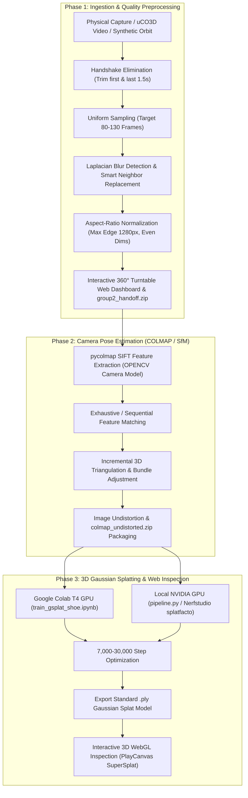

# ACM AI - End-to-End 3D Reconstruction & Gaussian Splatting Pipeline

An automated, production-ready pipeline uniting **physical video capture, uniform frame extraction, adaptive blur filtering, resolution normalization, Structure-from-Motion (COLMAP), and 3D Gaussian Splatting (3DGS)** model export.

---

## 📋 Architecture & Pipeline Flow



---

## ⚙️ Prerequisites & Installation

Clone and install dependencies:

```bash
# Clone the repository
git clone https://github.com/krishaygarg/3D_reconstruction.git
cd 3D_reconstruction

# Install Core Python requirements (OpenCV, NumPy, pycolmap, remotezip)
pip install -r requirements.txt
```

> [!NOTE]
> `pycolmap` runs natively on **macOS (Apple Silicon & Intel)** and **Linux/Windows**, allowing complete Structure-from-Motion without requiring an external C++ COLMAP installation.
> 3D Gaussian Splatting training requires CUDA GPU acceleration — run [`train_gsplat_shoe.ipynb`](file:///Users/arya/Desktop/FallACMAI/train_gsplat_shoe.ipynb) on a free **Google Colab T4 GPU**, or run [`pipeline.py`](file:///Users/arya/Desktop/FallACMAI/pipeline.py) on a local machine with an NVIDIA GPU.

---

## 🚀 Quick Start Guide

### 1. Unified Master Pipeline (`main.py`)

The master runner connects all phases end-to-end:

```bash
# Mode A: Run with zero arguments — streams uCO3D shoe sample from Hugging Face,
# extracts frames, runs COLMAP, and outputs shoe_colmap.zip for Colab:
python3 main.py

# Mode B: Run end-to-end on your own captured video (4K/1080p MP4/MOV):
python3 main.py --video path/to/my_orbit.mp4

# Mode C: Run COLMAP directly on a pre-extracted handoff zip:
python3 main.py --input group2_handoff.zip

# Mode D: Fully offline synthetic test (generates 360 orbit video and runs SfM):
python3 main.py --synthetic
```

Key CLI flags for `main.py`:
- `-v, --video`: Path to input video file.
- `-i, --input`: Input source (video, directory of images, or handoff `.zip`).
- `-w, --workspace`: Working directory (default: `ws`).
- `-n, --count`: Target frame count (default: `100`, within `[80, 130]`).
- `--max-side`: Max edge in pixels (default: `1280`).
- `--sequential`: Use sequential feature matching (fast for 360 orbits).
- `--no-filter`: Disable handshake trimming and adaptive blur filtering.
- `--archive`: Output archive filename (default: `colmap_undistorted.zip`).

---

### 2. Physical Capture & Preprocessing (`process_video.py` / `extract_ffmpeg.sh`)

Follow [`CAPTURE_GUIDE.md`](file:///Users/arya/Desktop/FallACMAI/CAPTURE_GUIDE.md) to record a physical 4K 60 FPS orbit. Then process with either engine:

```bash
# Python Engine: Adaptive Laplacian blur detection + smart neighbor replacement:
python3 process_video.py -i raw_capture.mov -o extracted_frames -a group2_handoff.zip

# FFmpeg Direct Shell Script:
./extract_ffmpeg.sh raw_capture.mov extracted_frames group2_handoff.zip 100
```

---

### 3. Interactive 360 Turntable Web Dashboard & Video Converter

Inspect frames, view sharpness metrics, or convert video directly in your web browser:

```bash
python3 -m http.server 8000
```
Open **`http://localhost:8000`** in your browser:
- **Client-Side Video Converter**: Drop any video file into the browser to extract, normalize to 1280px, and inspect client-side.
- **Drag-to-Rotate**: Scrub smoothly around the 360° turntable.
- **Interactive Sharpness Distribution**: Retina-sharp canvas displaying sharp frames (cyan), smart replaced frames (amber), and blurry frames (rose).
- **1-Click ZIP Deliverable**: Download `group2_handoff.zip` with image sequence and `dataset_metadata.json`.

---

### 4. Standalone COLMAP Pose Estimation (`colmap.py`)

Run Structure-from-Motion on any image directory using `pycolmap`:

```bash
python3 colmap.py -i extracted_frames -w ws -z colmap_undistorted.zip
```
This performs feature extraction, feature matching, incremental mapping, and undistorts images into `ws/undistorted/images` and `ws/undistorted/sparse/0/*.bin`.

---

### 5. 3D Gaussian Splatting Training (Google Colab & Nerfstudio)

#### Pathway A: Google Colab with `gsplat` (Recommended for Mac / No NVIDIA GPU)
1. Upload the generated `colmap_undistorted.zip` (or `shoe_colmap.zip`) to the root of your **Google Drive**.
2. Open [`train_gsplat_shoe.ipynb`](file:///Users/arya/Desktop/FallACMAI/train_gsplat_shoe.ipynb) in **Google Colab**.
3. Set runtime to **GPU (T4)**: `Runtime → Change runtime type → T4 GPU`.
4. Run all cells:
   - Installs `gsplat==1.5.3`.
   - Trains `simple_trainer.py` for 7,000 steps (~10 min) or 30,000 steps for full fidelity.
   - Automatically saves the trained `.ply` Gaussian Splat to your Google Drive!

#### Pathway B: Local Training via Nerfstudio (`pipeline.py`)
If running on a machine with an NVIDIA GPU and CUDA:
```bash
python3 pipeline.py --video my_orbit.mp4 --iterations 7000
# For production quality preset:
python3 pipeline.py --video my_orbit.mp4 --high-quality
```

---

### 6. Interactive 3D Model Inspection

Once the `.ply` file is exported:
1. Open [PlayCanvas SuperSplat Editor](https://playcanvas.com/supersplat/editor) in any web browser.
2. Drag and drop your exported `.ply` file directly into the viewer.
3. Orbit, fly through, crop floaters, adjust spherical harmonics, and export web-embeddable 3D scenes!

---

## 🛠️ Automated Testing & Verification Suite

The repository contains an automated verification suite covering all 3 phases:

```bash
python3 test_pipeline.py
```

The test suite validates:
1. Pipeline execution and frame count bounds ($80 \le N \le 130$).
2. Longest-edge resolution normalization to 1280px with preserved aspect ratio.
3. Handshake start/end trimming (1.5s).
4. Handoff archive compression and `dataset_metadata.json` schema integrity.
5. Arbitrary and ultra-short video conversion.
6. Portrait / vertical video downscaling (e.g., $720 \times 1280$).
7. Odd dimension safety (guaranteeing even pixel dimensions for tensor tiling).
8. Blur detection and smart neighbor replacement ($\pm 5$ frame window).
9. Safe packaging when archive path is inside the output directory.
10. Fixed FPS sampling mode.
11. Ingestion module extraction integration (`video.py`).
12. COLMAP feature extraction and directory structure initialization (`colmap.py`).

---

## 📦 Project Structure

```text
3D_reconstruction/
├── main.py                    # Unified master end-to-end pipeline runner
├── process_video.py           # Phase 1: Video extraction, blur filter, normalization
├── extract_ffmpeg.sh          # Phase 1: Fast direct FFmpeg script
├── colmap.py                  # Phase 2: pycolmap Structure-from-Motion & undistortion
├── video.py                   # Ingestion: uCO3D Hugging Face streaming via RemoteZip
├── pipeline.py                # Phase 2 & 3: Nerfstudio / splatfacto pipeline
├── train_gsplat_shoe.ipynb    # Phase 3: Google Colab T4 GPU training notebook (gsplat)
├── test_pipeline.py           # Automated test suite (12 verification tests)
├── generate_sample_video.py   # Procedural synthetic 360° orbit video generator
├── CAPTURE_GUIDE.md           # Live camera recording field manual
├── requirements.txt           # Unified dependency specifications
├── index.html                 # Interactive 360° Turntable Web Dashboard
├── viewer.js                  # Client-side 360° player & browser video converter
└── styles.css                 # Obsidian dark-mode dashboard styling
```
